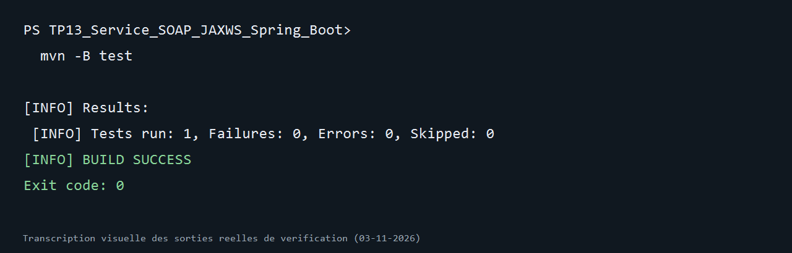

# TP13 — Service SOAP JAX-WS avec Spring Boot

Projet Maven Java 17 basé sur le [TP13 du cours](https://mliaedu.toubkalit.com/student/courses/7/labs/166). Le service CXF expose quatre opérations SOAP pour gérer des comptes bancaires dans H2.

## Démarrer

```bash
mvn clean test
mvn spring-boot:run
```

Le WSDL est à `http://localhost:8082/services/ws?wsdl`. Importez-le dans SoapUI pour appeler `getComptes`, `getCompteById`, `createCompte`, `updateCompte` et `deleteCompte`. `updateCompte` complète le contrat du TP afin que le bouton « Modifier » du client Android TP14 fonctionne. La console H2 est à `http://localhost:8082/h2-console` avec `jdbc:h2:mem:testdb`, utilisateur `sa` et mot de passe vide.

Pour utiliser le client Android du TP14, démarrez ce serveur puis pointez l’émulateur vers `http://10.0.2.2:8082/services/ws`. Le nom d’espace SOAP de ce service est `http://ws.demo.example.com/`.

Les imports JPA/JAX-WS utilisent Jakarta, conformément à Spring Boot 3. Le port et le chemin CXF sont fixés explicitement afin que l'URL du WSDL corresponde à la configuration.

## Résultat vérifié

Commande exécutée le 3 novembre 2026 :

```powershell
mvn -B test
```

1 test d’intégration du service SOAP réussi avec H2 (0 échec).



L’image est une transcription visuelle de la sortie réelle de vérification ; la capture native de la fenêtre du terminal n’était pas disponible dans cet environnement.
